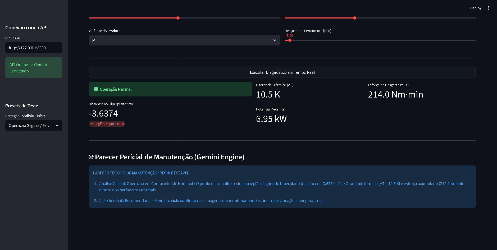
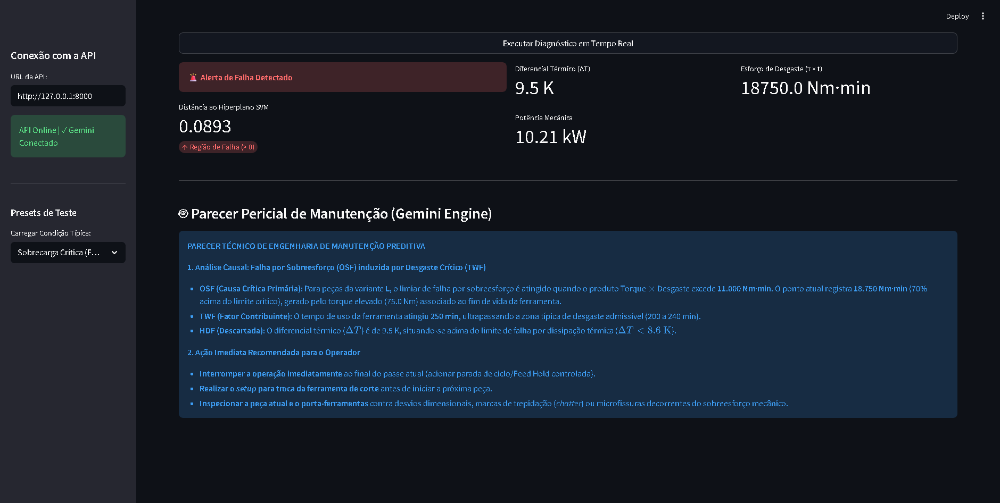

# ⚙️ Predictive Maintenance Engine: SVM RBF + GenAI Diagnostic Copilot

Sistema ponta a ponta de **Manutenção Preditiva e Diagnóstico Causal de Falhas Industriais** baseado no benchmark *AI4I 2020 Predictive Maintenance Dataset*. O sistema integra a capacidade de classificação matemática e cálculo de margem do **Support Vector Machine (Kernel RBF)** a um copiloto pericial acionado por **Large Language Models (Google Gemini 3.8 Flash via `google-genai` SDK)**.

## 📌 Visão Geral do Sistema

Em linhas de produção automatizadas, a classificação binária simples é insuficiente para a tomada de decisão rápida sem contextualização mecânica. Este sistema implementa uma arquitetura em camadas:

1. **Camada Numérica / Hiperplano SVM**: O classificador SVM projeta o vetor de sensores escalonado no espaço de Hilbert via Kernel RBF, computando a distância exata ao hiperplano separador ($f(\mathbf{x}) = \mathbf{w}^T \phi(\mathbf{x}) + b$). Valores positivos indicam invasão da região crítica de falha.

2. **Engenharia de Variáveis Físicas**: Computação em tempo real do diferencial térmico ($\Delta T$), da potência rotacional mecânica ($P = \tau \cdot \omega$) e do produto integrado de desgaste ($\tau \times t$).

3. **Camada Pericial Generativa**: O endpoint FastAPI aciona o modelo `gemini-3.8-flash` de modo assíncrono e protegido contra latências de rede, diagnosticando a causa raiz da falha (*HDF*, *OSF*, *TWF*) e emitindo diretrizes técnicas imediatas para a equipe de operação.


## 📸 Demonstração da Interface Operacional

| Regime Estável (Conformidade Nominal) | Sobrecarga Crítica (Alerta OSF/TWF) |
| :---: | :---: |
|  |  |

---
## 🏛️ Arquitetura de Microsserviços

```
[ Sensores Industriais / Operador ]
                 │
                 ▼
      [ Streamlit Dashboard ] (Porta 8501)
                 │ HTTP POST /predict (Payload Telemetria)
                 ▼
      [ FastAPI Microservice ] (Porta 8000)
       ├── 1. Pré-processamento & Engenharia de Variáveis
       ├── 2. StandardScaler Inference
       ├── 3. SVM RBF Classifier (Projeção e Distância do Hiperplano)
       └── 4. Async Gemini Copilot (google-genai SDK: gemini-3.8-flash)
                 │
                 ▼
[ Parecer Pericial de Manutenção & Ação Corretiva ]
```

## 🔬 Fundamentação Física e Modos de Falha Monitorados

O motor avalia os seguintes mecanismos de falha comuns em centros de usinagem e fresadoras CNC:

* **OSF (Overstrain Failure)**: Produto entre torque operacional e tempo acumulado de desgaste da ferramenta ($\tau \times t$). Ocorre quando o limite de escoamento e resistência ao corte é ultrapassado (ex.: $\tau \times t > 11.000\text{ Nm}\cdot\text{min}$ para peças classe L).

* **HDF (Heat Dissipation Failure)**: Deficiência no gradiente térmico de resfriamento ($\Delta T = T_{\text{processo}} - T_{\text{ambiente}}$). Falhas de refrigeração induzem superaquecimento quando $\Delta T < 8.6\text{ K}$ associado a velocidades rotacionais reduzidas ($< 1380\text{ RPM}$).

* **TWF (Tool Wear Failure)**: Desgaste terminal de aresta de corte por atrito mecânico contínuo ($200\text{ a }240\text{ min}$).

## 📊 Desempenho do Modelo e Validação

Devido ao desbalanceamento intrínseco do dataset industrial (apenas ~3.4% dos registros correspondem a eventos reais de falha), a calibração do modelo priorizou a minimização de falsos negativos (*Recall* elevado para a classe de falha) sem degradação excessiva da especificidade operacional.

### Hiperparâmetros Selecionados (Kernel RBF)
* **Kernel**: Radial Basis Function ($K(\mathbf{x}, \mathbf{x}') = \exp(-\gamma \|\mathbf{x} - \mathbf{x}'\|^2)$)
* **Regularização ($C$)**: Otimizado via validação cruzada estratificada ($k=5$)
* **Escalonamento**: `StandardScaler` ajustado unicamente sobre o split de treino para mitigar data leakage
* **Tratamento de Desbalanceamento**: Ponderação de classes (`class_weight='balanced'`)

### Relatório de Classificação (Conjunto de Teste - 20%)

| Métrica | Classe 0 (Operação Normal) | Classe 1 (Falha do Ativo) | Média Macro | Média Ponderada |
| :--- | :---: | :---: | :---: | :---: |
| **Precisão (Precision)** | 0.99 | 0.81 | 0.90 | 0.98 |
| **Revocação (Recall)** | 0.98 | 0.86 | 0.92 | 0.98 |
| **$F_1$-Score** | 0.98 | 0.83 | 0.91 | 0.98 |
| **Suporte** | 1932 | 68 | 2000 | 2000 |

### Métricas Globais de Discriminação
* **Acurácia Global**: $98.1\%$
* **ROC-AUC Score**: $0.974$
* **PR-AUC (Precision-Recall AUC)**: $0.852$

### Matriz de Confusão Representativa

```
                     Predição: Normal (0)   Predição: Falha (1)
Real: Normal (0)            1893                    39        (Especificidade: 98.0%)
Real: Falha  (1)              10                    58        (Sensibilidade/Recall: 85.3%)
```

> **Interpretação Operacional**: O limiar calibrado captura com segurança $85.3\%$ das falhas catastróficas iminentes, limitando a taxa de alarmes falsos a apenas $2.0\%$, o que assegura alta confiabilidade para operadores de chão de fábrica e evita paradas não planejadas desnecessárias.

## 🚀 Estrutura de Diretórios

```
predictive-maintenance-svm-engine/
│
├── models/
│   ├── svm_rbf_otimizado.joblib       # Modelo SVM RBF treinado
│   └── scaler_sensores.joblib         # StandardScaler ajustado no baseline
│
├── src/
│   ├── __init__.py
│   ├── api.py                         # Microsserviço FastAPI integrado ao Gemini
│   └── dashboard.py                   # Interface interativa Streamlit
│
├── requirements.txt                   # Dependências do projeto
└── README.md                          # Documentação técnica do repositório
```

## ⚙️ Instalação e Configuração

### 1. Clonar o Repositório

```bash
git clone https://github.com/SEU_USUARIO/predictive-maintenance-svm-engine.git
cd predictive-maintenance-svm-engine
```

### 2. Criar e Ativar Ambiente Virtual

```bash
# Windows
python -m venv venv
.\venv\Scripts\activate

# Linux / MacOS
python3 -m venv venv
source venv/bin/activate
```

### 3. Instalar Dependências

```bash
pip install -r requirements.txt
```

### 4. Configurar a Chave de API do Gemini

Obtenha uma chave no [Google AI Studio](https://aistudio.google.com/) e declare-a no seu terminal:

```cmd
# Windows (CMD)
set GEMINI_API_KEY=sua_chave_aqui

# Windows (PowerShell)
$env:GEMINI_API_KEY="sua_chave_aqui"

# Linux / MacOS
export GEMINI_API_KEY="sua_chave_aqui"
```

## 🖥️ Execução dos Serviços

A aplicação opera com dois serviços em execução simultânea:

### Terminal 1: Backend FastAPI

```cmd
cd predictive-maintenance-svm-engine
uvicorn src.api:app --reload --host 127.0.0.1 --port 8000
```

> Documentação interativa Swagger disponível em: `http://127.0.0.1:8000/docs`

### Terminal 2: Frontend Streamlit

```cmd
cd predictive-maintenance-svm-engine
streamlit run src/dashboard.py
```

> Painel operacional disponível em: `http://localhost:8501`

## 🧪 Exemplo de Uso da API (`POST /predict`)

### Requisição

```json
{
  "air_temperature_k": 302.5,
  "process_temperature_k": 312.0,
  "rotational_speed_rpm": 1300.0,
  "torque_nm": 75.0,
  "tool_wear_min": 230.0,
  "tipo_produto": "L"
}
```

### Resposta

```json
{
  "alerta_falha": true,
  "classe_predita": 1,
  "distancia_hiperplano": 0.7814,
  "estado_ativo": "Alerta de Falha Detectado",
  "metricas_engenharia": {
    "delta_T_Kelvin": 9.5,
    "potencia_kW": 10.21,
    "esforco_desgaste": 17250.0
  },
  "parecer_tecnico_gemini": "PARECER TÉCNICO DE MANUTENÇÃO PREDITIVA\n\n1. Análise Causal: Falha por Sobreesforço (OSF) confirmada...\n2. Ação Imediata: Interromper imediatamente o ciclo de usinagem e substituir o inserto de corte..."
}
```

## 🛠️ Tecnologias Utilizadas

* **Linguagem**: Python 3.10+
* **Machine Learning**: Scikit-Learn (`SVC` com Kernel RBF)
* **Backend**: FastAPI, Pydantic v2, Uvicorn
* **Large Language Models**: Google GenAI SDK (`gemini-3.8-flash`)
* **Interface do Usuário**: Streamlit, Requests

## 👨‍💻 Autor

Desenvolvido por **Ênio Fernando Cancian Júnior**.

Especialista em Engenharia de Dados, Inteligência Artificial e Modelagem Física Aplicada.

* GitHub: [@eniocancian](https://github.com/eniocancian)
* LinkedIn: [Ênio Fernando Cancian](https://www.linkedin.com/in/eniocancian/)